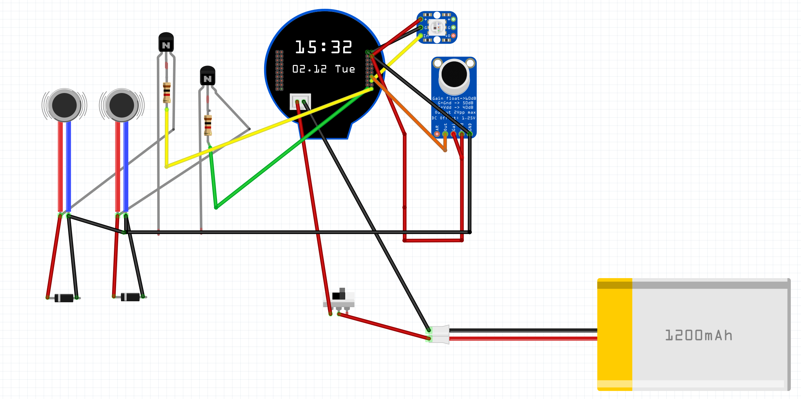

# Magic (GPT)8 Ball 🎱

## Overview

The Magic (GPT)8 Ball is a modern reinvention of the classic fortune-telling toy, powered by AI and IoT technology. It features voice recognition, motion sensing, and real-time AI responses through ChatGPT. When shaken, it records your question through a built-in microphone, processes it using OpenAI's APIs, and displays a mystical response on its integrated circular display.

## Features

- Voice-activated recording with automatic silence detection
- Motion-based activation using QMI8658 6-axis IMU
- Real-time transcription using OpenAI's Whisper API
- AI-powered responses from ChatGPT
- Smooth animations and UI transitions
- RGB LED status indicator
- Haptic feedback through dual vibration motors
- WiFi manager for easy network setup
- Offline mode with classic Magic 8 Ball responses
- Built-in battery management and charging

## Hardware Requirements



### Core Components

- Waveshare ESP32-S3 1.28" LCD Development Board
  - ESP32-S3 microcontroller
  - 1.28" Round LCD Display (240×240 resolution)
  - Built-in QMI8658 6-axis IMU
  - USB-C for programming and charging
- MAX9814 Microphone Amplifier Module
- 2x Vibration Motors
- WS2812B RGB LED
- 1200mAh LiPo Battery
- 3D printed enclosure (files TBD)

### Pin Connections

#### Built-in Components (ESP32-S3 Board)

- LCD Display
  - DC: GPIO8
  - CS: GPIO9
  - CLK: GPIO10
  - MOSI: GPIO11
  - RST: GPIO12
  - BL: GPIO40
- QMI8658 IMU
  - SDA: GPIO6
  - SCL: GPIO7

#### External Components

- MAX9814 Microphone
  - VDD → 3.3V
  - GND → GND
  - OUT → GPIO2 (ADC1_CH1)
- Vibration Motors
  - Motor 1: GPIO5
  - Motor 2: GPIO13
- RGB LED: GPIO3

## Software Setup

### Development Environment

1. Install Visual Studio Code
2. Install PlatformIO IDE extension
3. Clone the repository:

   ```bash
   git clone https://github.com/NickEngmann/MagicGPT8Ball.git
   cd MagicGPT8Ball
   ```

### Dependencies

- WiFiManager for network configuration
- ArduinoJson (7.x) for API communication
- LVGL for UI and animations
- TFT_eSPI for display driver
- Adafruit_NeoPixel for RGB LED control

### APIs and Services

1. Set up a val.town account:
   - Deploy the included `val.town.js` function
   - Update the endpoint URL in `main.cpp`
2. Configure OpenAI API key in val.town environment

### Environment Configuration

1. In the project root directory, create a `.env` file with your val.town endpoint and device token:

   ```ini
   VALTOWN_URL="https://your-valtown-endpoint.val.run"
   DEVICE_TOKEN="your-device-token"
   ```

2. For reference, an `.env.example` file is provided:

   ```ini
   VALTOWN_URL="https://example-valtown-endpoint.val.run"
   DEVICE_TOKEN="example-device-token"
   ```

   **Note:** Never commit your actual `.env` file to version control. The `.env.example` file serves as a template.

3. File locations should follow this structure:

   ```
   MagicGPT8Ball/
   ├── .env                  # Your actual configuration (do not commit)
   ├── .env.example         # Template for others (safe to commit)
   ├── generate_env.py      # Handles environment setup
   ├── data/                # Generated during build
   └── ...
   ```

4. During build:
   - The system automatically copies your `.env` file to the device's filesystem
   - If `.env` is missing, it will use `.env.example` as a fallback
   - Environment variables are securely stored on the device

5. To update configuration:
   - Modify `.env` file
   - Rebuild and upload filesystem:

     ```bash
     pio run -t uploadfs
     ```

   - Upload program:

     ```bash
     pio run -t upload
     ```

### Local WAV Server Setup

For local development and testing, you can run a WAV upload server:

```bash
# Install Python dependencies
pip install flask

# Run the local server
python wav_server.py
```

The server listens on `http://localhost:5000` and provides endpoints for:
- WAV file upload with validation
- Batch uploads
- File listing and deletion
- Cleanup of old files

See [API Endpoints](#api-endpoints) section for full details.

## Usage Instructions

### First-Time Setup

1. Power on the device
2. Connect to "MagicGPT8Ball" WiFi network
3. Configure your WiFi through the captive portal
4. Device will restart and connect to your network

### Daily Use

1. Wake device by moving it or pressing the power button
2. Wait for "Shake me" prompt
3. Shake device to activate recording
4. Speak your question clearly
5. Wait for response (blue animation indicates processing)
6. Device will display the AI-generated response
7. Shake again for a new question

### LED Status Indicators

- Blue pulse: Starting up
- Solid green: Ready
- Red blink: Recording
- Cyan pulse: Processing
- Yellow blink: Offline mode
- Purple blink: Error state

## Advanced Features

### Debug Mode

Enable detailed logging by uncommenting `#define ENABLE_DEBUG` in the following files:

- `Recorder.h` - Audio debugging
- `main.cpp` - System debugging

### Voice Detection Parameters

Adjust sensitivity in `Recorder.h`:

- `AUDIO_THRESHOLD`: Voice detection threshold
- `SILENCE_TIMEOUT`: Silence duration before stopping
- `MAX_RECORD_SECONDS`: Maximum recording duration

### Animation Settings

Customize animations in `Animations.h`:

- `MOTION_SMOOTHING`: Movement smoothness
- `GYRO_SENSITIVITY`: Motion sensitivity
- `IDLE_AMPLITUDE`: Idle animation range

## Testing

This project uses a hybrid testing approach with Python and C++ tests.

### Python Tests

Run Python tests using pytest:

```bash
# Install test dependencies
pip install pytest flask pillow

# Run all Python tests
pytest tests/ -v

# Run specific test file
pytest tests/test_wav_server.py -v
pytest tests/test_jpg_to_sjpg.py -v
```

### Test Coverage Summary

| Test File | Tests | Coverage | Status |
|-----------|-------|----------|--------|
| test_wav_server.py | 24 | WAV upload server | 24/24 passed |
| test_jpg_to_sjpg.py | 20 | SJPG conversion | 20/20 passed |
| **Total** | **44** | **All Python tests** | **44/44 passed** |

**Python Test Coverage Includes**:
- WAV header validation and file uploads
- Flask endpoint testing (upload, batch, health, list, delete, cleanup)
- Image conversion validation
- SJPG header and C array generation
- Memory and cleanup operations

### C++ Tests

C++ unit tests use the Unity framework for ESP32 hardware testing:

```bash
# Run PlatformIO native tests (requires simulator or hardware)
pio test -e waveshare_esp32_s3
```

**C++ Test Files**:
- `test/test_native/test_placeholder.c` — Unity framework smoke test
- `test/test_lvgl_render/lvgl_test_helper.h` — LVGL headless test helper for display testing

### Running All Tests

```bash
# Python tests
pytest tests/ -v

# C++ tests (requires PlatformIO environment)
pio test -e waveshare_esp32_s3
```

### Building and Flashing

1. Open project in VS Code with PlatformIO
2. Install dependencies:

   ```bash
   pio lib install
   ```

3. Build and upload:

   ```bash
   pio run --target upload
   ```

4. Build and upload filesystem:

   ```bash
   pio run -t buildfs
   pio run -t uploadfs
   ```

## Project Structure

```
├── src/
│   ├── main.cpp              # Main application logic
│   ├── Animations.*          # Display animations
│   ├── Recorder.*           # Audio recording
│   ├── TextStateManager.*   # Display text handling
│   ├── VibrationManager.*   # Haptic feedback
│   └── LEDLogger.*         # RGB LED control
├── lib/
│   └── QMI8658/            # IMU driver
└── val.town.js             # Serverless API handler
```

## Troubleshooting

### Common Issues

1. WiFi Connection Problems
   - Reset configuration by holding boot button
   - Check serial output for connection status
   - Verify network credentials in portal

2. Recording Issues
   - Check microphone connections
   - Verify ADC readings in debug mode
   - Adjust voice detection threshold

3. Display Problems
   - Verify SPI connections
   - Check power supply voltage
   - Update TFT_eSPI configuration

### Error Messages

- "Wifi: X" - No network connection
- "Error: processing request" - API communication failed
- "Error: recording failed" - Audio capture issue

## WAV Server API

The project includes a Flask-based WAV file upload server (`wav_server.py`) for local development and testing.

### Running the Server

```bash
pip install flask
python wav_server.py
```

The server runs on `http://localhost:5000` by default.

### API Endpoints

| Endpoint | Method | Description |
|----------|--------|-------------|
| `/upload_wav` | POST | Single WAV upload with validation |
| `/upload_wav_batch` | POST | Batch WAV upload |
| `/health` | GET | Health check endpoint |
| `/uploads` | GET | List uploaded files (supports pagination) |
| `/uploads/delete/<filename>` | DELETE | Delete specific uploaded file |
| `/cleanup` | POST | Clean up old uploads by age |

### Request Examples

**Single Upload:**
```bash
curl -X POST -F "file=@recording.wav" http://localhost:5000/upload_wav
```

**List Uploads:**
```bash
curl http://localhost:5000/uploads?limit=10&offset=0
```

**Delete File:**
```bash
curl -X DELETE http://localhost:5000/uploads/delete/recording_20260325_120000_abc123.wav
```

**Health Check:**
```bash
curl http://localhost:5000/health
```

### Response Format

Successful upload returns:
```json
{
  "success": true,
  "filename": "recording_20260325_120000_abc123.wav",
  "filepath": "/path/to/wav_uploads/recording_20260325_120000_abc123.wav",
  "file_size": 512345,
  "checksum": "d41d8cd98f00b204e9800998ecf8427e",
  "metadata": {
    "sample_rate": 16000,
    "channels": 1,
    "bits_per_sample": 16,
    "duration_seconds": 10.5
  }
}
```

### Features

- WAV file header validation (RIFF, WAVE, fmt, data chunks)
- Automatic file size checking (10MB max)
- MD5 checksum generation
- Batch upload support
- Pagination for file listing
- Automatic cleanup of old files
- Detailed error messages

## Contributing

1. Fork the repository
2. Create a feature branch
3. Follow existing code style
4. Add unit tests if applicable
5. Submit a pull request

## License

This project is licensed under the MIT License.

## Acknowledgments

- OpenAI for ChatGPT and Whisper APIs
- Waveshare for ESP32-S3 hardware
- LVGL team for graphics library
- val.town for serverless hosting
- ArduinoJson library authors
- WiFiManager community
- Adafruit NeoPixel library
- Open source community for libraries and tools
